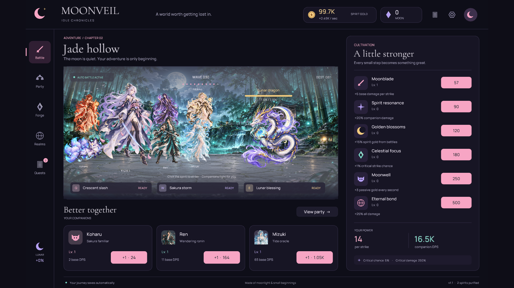

# Moonveil · Idle Chronicles

A native Rust anime idle RPG about moonlight, small beginnings, and a very persistent fox.



## Play

Download **Moonveil-1.1.0-macOS-arm64.zip** from [Releases](https://github.com/MaybeMotion/Moonveil/releases/latest), unzip it, and double-click **Moonveil.app**. Everything it needs—art, fonts, sound, and music—is bundled into the executable. No internet connection or Rust installation is needed to play this Apple Silicon Mac build.

To run from source, install Rust and use `cargo run --release --locked`. To create the Mac app bundle, run `./scripts/package-macos.sh`.

Click the floating spirit or press **Space** to attack. Koharu, your first companion, already fights automatically. Spend spirit gold on companions and cultivation, craft relics, and collect quest rewards. Enemies rotate through realm-specific rosters: moon foxes, sakura slimes, jade kodama, astral moths and clockwork lanterns. Every tenth wave brings a distinct guardian—Jade colossus, Ember oni or Lunar dragon—which drops a moon crystal.

| Key | Action |
| --- | --- |
| Space | Strike |
| Q | Crescent slash: 8× strike damage + 2 seconds of party damage; 8-second cooldown |
| W | Sakura storm: double all damage for 12 seconds; 30-second cooldown |
| E | Lunar blessing: 60 seconds of estimated gold, minimum 30; 45-second cooldown |
| S | Save immediately |
| Esc | Open or close settings |
| F11 | Toggle fullscreen |

## Your journey

- Six companions with 100 levels each. Recruited allies appear beside Yuki as full-body battle sprites, with individual idle motion and attack effects.
- Six training paths with 100 levels each.
- Six relics with 25 ranks each; all equip automatically and stack.
- Five realms, unlocked at waves 1, 21, 41, 61, and 81. Progression continues to wave 500.
- Six one-time quests and a moon-crystal gold exchange.
- Ascension from wave 50: reset the run for +20% permanent damage per blessing. Gain one blessing per 25 run-best waves. Lifetime records, crystals, and claimed quests remain; current gold, party levels, training, relics, and realm access reset.
- Autosave every 15 seconds and when closing the window normally.
- Offline expeditions: 50% of estimated current battle-gold rate for up to 8 hours. They grant gold without advancing waves or awarding boss crystals.
- Original anime illustrations, a visible battle party, eight enemy designs, sword arcs, petals, critical hits, particles, and synthesized ambience and effects.
- Automatic display fitting in windowed mode and fullscreen. The 16:10 game canvas scales uniformly with centered padding; artwork, text, circles, and mouse targets retain their proportions on wide, tall, or Retina displays.

Saves live in `~/Library/Application Support/Moonveil/save.json`, outside this project. Unreadable JSON saves are copied to a timestamped backup before a new journey begins. For an isolated test save, set `MOONVEIL_SAVE_PATH` to another absolute JSON path.

## Develop

```sh
cargo run --locked
cargo test --locked
cargo clippy --all-targets --locked -- -D warnings
./scripts/package-macos.sh
```

The game uses [Macroquad](https://docs.rs/macroquad/0.4.16/macroquad/), with Serde JSON for persistence. All gameplay and UI logic is Rust. `src/game.rs` contains the independent progression model; `src/main.rs` contains rendering, animation, input, and audio. `src/display.rs` defines aspect-preserving screen fitting and mouse mapping; `src/bestiary.rs` defines realm enemy rotations and guardians. Assets are embedded at compile time. `Cargo.lock` pins the dependency versions.

`cargo run --release -- --smoke-test` exercises all screens, all eight enemies, the full recruited battle party, wide/square/portrait/fullscreen scaling, attacks, skills, recruiting, training and forging without reading or writing your save. The test captures screens to `MOONVEIL_CAPTURE_DIR` (or `work/captures` in the current directory).

Artwork was generated with the built-in ImageGen tool for this project. The original prompt set is in `ART_PROMPTS.json`; the enemy and full-body companion additions are in `ART_PROMPTS_V1_1.json`. Both use the built-in ImageGen tool. Audio is original procedural synthesis; regenerate it with `python3 scripts/make_audio.py`. Manrope and Cormorant Garamond are distributed under their included SIL Open Font Licenses.

The downloadable Mac app is built for Apple Silicon and locally ad-hoc signed. Other platforms can build from the Rust source; those builds have not been verified here.

